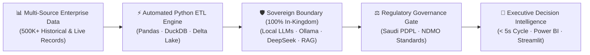
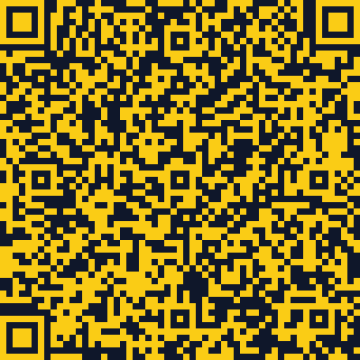

<div align="center">

# قُدْ القرار الأذكى
# Salman Alharbi | سلمان الحربي

### **Decision Intelligence & Data Governance Specialist (PDPL & NDMO) | Data Science & MLOps**
#### **أخصائي ذكاء القرار وحوكمة البيانات (PDPL & NDMO) | علوم البيانات واستشارات الأعمال التقنية**

*Bridging Enterprise Data Architectures, Sovereign Regulatory Compliance, and Measurable ROI.*  
*الربط بين معمارية بيانات المؤسسات، والامتثال التنظيمي السيادي، والعائد الاستثماري القابل للقياس.*

<p align="center">
  <a href="https://salman-qq.github.io/Portfolio/">
    
  </a>
  <a href="https://salman-qq.github.io/Portfolio/#roi-simulator">
    
  </a>
  <a href="./SALMAN-ALHARBI-Resume.pdf">
    
  </a>
  <a href="./Salman_Alharbi.vcf">
    
  </a>
  <a href="https://www.linkedin.com/in/salman-alharbi-data-scientist">
    
  </a>
</p>

</div>

---

## ⚡ Executive Impact at a Glance | أبرز المؤشرات والأثر المؤسسي

| Metric / المؤشر | Institutional Benchmark / النتيجة المحققة | Entity & Context / الجهة والسياق |
| :--- | :---: | :--- |
| **Big Data Ingestion Speed**<br/>سرعة استيعاب البيانات الضخمة | **`500,000+ Records in 15 mins`**<br/>أكثر من 500 ألف سجل خلال 15 دقيقة | **SERA** — Harvested 4-year regulatory backlog & scaled to 4 enterprise clients |
| **Decision Cycle Compression**<br/>تقليص دورة اتخاذ القرار | **`Hours ➔ < 5 Seconds`**<br/>من ساعات عمل إلى أقل من 5 ثوانٍ | **SERA** — Powered by Sovereign Local LLMs (Ollama / DeepSeek) |
| **Sovereign Data Residency**<br/>توطين البيانات والامتثال السيادي | **`100% In-Kingdom (PDPL & NDMO)`**<br/>توطين محلي 100% دون تسريب سحابي | **SERA** — Full compliance with Saudi PDPL & NDMO standards |
| **Operational Bandwidth Freed**<br/>توفير النطاق التشغيلي للفريق | **`15 Analytics Team Members`**<br/>تفريغ الوقت التشغيلي لـ 15 محللاً | **NCM** — Automated hourly meteorological ETL pipelines (Python / DuckDB) |
| **Deep Learning Vision Pipeline**<br/>دقة نماذج الرؤية الحاسوبية (IEEE) | **`93% Severity · 100% Part ID`**<br/>على 23,874 صورة عبر 21 قطعة | **IEEE 6-Page Paper** — Automated Insurance Decision Support System |
| **Real Estate Valuation Engine**<br/>دقة محرك التقييم العقاري | **`R² = 0.919 (7 ML Models)`**<br/>معامل تفسير 0.919 عبر 7 خوارزميات | **KSA Real Estate** — End-to-end spatial & market feature engineering |

---

## 🏛️ Sovereign Decision Intelligence Architecture | المعمارية السيادية لذكاء القرار



---

## 🧮 Operational Impact & Sovereign AI Calculator | حاسبة الأثر التشغيلي والذكاء الاصطناعي السيادي

> 🔗 **[Launch Live Interactive Calculator on GitHub Pages ➔](https://salman-qq.github.io/Portfolio/#roi-simulator)**  
> *Modeled on production deployments at SERA, NCM, IEEE Insurance Research, and Hajj-scale crowd/operational ecosystems.*

```text
Monthly_Hours_Saved = (Team × 42h) + [(Records_Volume / 10,000) × (3.2 + 0.35 × Team)]
Annual_SAR_Saved    = (Monthly_Hours_Saved × 12 × 145 SAR) + [(Records_Volume / 1,000) × 62 SAR Token_API_Offset]
```

| Executive Scenario / السيناريو التشغيلي | Volume & Team / الحجم والفريق | Decision Cycle / سرعة القرار | Hours Saved / الوفر الشهري | Annual ROI & Token Savings / الوفر السنوي | Data Residency / السيادة (PDPL) |
| :--- | :---: | :---: | :---: | :---: | :---: |
| **🕋 Hajj & Crowd Ops**<br/>منظومة الحج والمشاعر المليونية | `1,500,000 Records`<br/>`15 Analysts` | **`< 5 sec`**<br/>*(vs ~84h manual)* | **`1,898 hrs/mo`** | **`3.39M SAR / yr`**<br/>*(Zero Cloud Token Fees)* | **`100% In-Kingdom`**<br/>🛡️ *PDPL & NDMO Safe* |
| **⚡ SERA Regulatory Platform**<br/>هيئة تنظيم المياه والكهرباء | `500,000 Records`<br/>`10 Analysts` | **`< 5 sec`**<br/>*(vs ~30h manual)* | **`755 hrs/mo`** | **`1.34M SAR / yr`**<br/>*(Zero Cloud Token Fees)* | **`100% In-Kingdom`**<br/>🛡️ *PDPL & NDMO Safe* |
| **🚗 IEEE Insurance Vision AI**<br/>نظام دعم القرار التأميني (IEEE) | `250,000 Records`<br/>`8 Analysts` | **`< 5 sec`**<br/>*(vs ~16h manual)* | **`486 hrs/mo`** | **`861K SAR / yr`**<br/>*(Zero Cloud Token Fees)* | **`100% In-Kingdom`**<br/>🛡️ *PDPL & NDMO Safe* |
| **🌦️ NCM Meteorology ETL**<br/>المركز الوطني للأرصاد | `150,000 Records`<br/>`15 Analysts` | **`< 5 sec`**<br/>*(vs ~9h manual)* | **`757 hrs/mo`** | **`1.33M SAR / yr`**<br/>*(Zero Cloud Token Fees)* | **`100% In-Kingdom`**<br/>🛡️ *PDPL & NDMO Safe* |

---

## 💼 Professional Experience | الخبرات المهنية

### 1. **Lead Technical Instructor (Technical Trainer)** — *Tuwaiq Academy (in partnership with Ministry of Education)*
📍 *Jeddah, Saudi Arabia | 07/2026 – 08/2026*  
🏅 **Honor:** *Executive Leadership Commendation (شهادة شكر وتقدير من القيادة التنفيذية)*
- **Regional Cohort Leadership:** Led gifted, advanced technologies, and AI tracks at the Jeddah hub, coordinating daily operations and serving as the primary executive liaison with academy leadership.
- **Technical Translation & Mentorship:** Delivered university-grade Generative AI, Prompt Engineering, MLOps, and Cybersecurity modules, guiding applied IoT (Arduino) & VR (Unity) student prototyping.
- **Executive Event Direction:** Orchestrated the final grand technology exhibition and coached student speakers for stage delivery.

### 2. **Data Science & Decision Intelligence Specialist** — *Saudi Electricity Regulatory Authority (SERA)*
📍 *Riyadh, Saudi Arabia (via Universal Steps Group) | 12/2025 – 06/2026*  
🏅 **Credential:** *Tamheer On-the-Job Training Completion Certificate*
- **Big Data Pipeline Scalability:** Engineered an enterprise ETL ingestion engine harvesting a 4-year data backlog (**500K+ records**) in **15 minutes**; scaled the framework to support **4 additional enterprise clients**.
- **Sovereign Local LLMs & PDPL Compliance:** Compressed the operational decision loop from hours to **< 5 seconds** using secure Local LLMs, maintaining **100% data residency** per **Saudi PDPL & NDMO** standards.
- **Executive Decision Intelligence & Sentiment Analytics:** Transformed multi-source operational data and 5+ digital platforms into executive-ready dashboards for regulatory oversight and reputation protection.

### 3. **Data Engineer Intern** — *National Center of Meteorology (NCM)*
📍 *Jeddah, Saudi Arabia | 06/2024 – 08/2024*  
🏅 **Impact:** *Freed Operational Bandwidth for 15 Analytics Team Members*
- **Process Automation:** Architected automated Python (Pandas, Regex) ETL pipelines for hourly weather reports and ICAO flight arrival classification, cutting latency from hours to seconds.
- **Data Integrity & DevOps:** Integrated **Delta Lake** for transactional reliability and optimized SQL queries in **DuckDB** using **Docker** containers and **Git**.

---

## 🚀 Featured Projects & Research | المشاريع والأبحاث البارزة

### 🔬 1. Automated Insurance Decision Support System *(Principal Investigator • 6-Page IEEE Paper)*
> **Tech Stack:** `YOLOv8` · `EfficientNetB0` · `OpenCV` · `Pandas` · `Streamlit` · `Actuarial Cost Engine`
- Authored a peer-reviewed **6-page IEEE research paper** as Principal Investigator & First Author.
- Built a sequential **3-model deep learning pipeline** trained and evaluated on **23,874 real-world collision images**, achieving **81% damage detection**, **93% severity grading**, and **100% part identification** across **21 vehicle components**.
- Deployed an interactive Streamlit platform generating audit-ready bilingual PDF financial claim dossiers in **under 60 seconds**.

### 📈 2. Saudi Real Estate Investment Valuation Engine
> **Tech Stack:** `RandomForest` · `XGBoost` · `Scikit-Learn` · `Spatial Feature Engineering` · `Python`
- Benchmarked **7 machine learning architectures** (Linear, Ridge, Lasso, Decision Tree, Gradient Boosting, XGBoost, RandomForest) for regional property appraisal.
- Achieved **$R^2 = 0.919$** explained variance with automated spatial and market feature engineering to guide risk-controlled acquisition decisions.

### 🛡️ 3. SERA Regulatory Intelligence & Sovereign Data Platform
> **Tech Stack:** `Local LLMs (Ollama / DeepSeek)` · `Saudi PDPL` · `NDMO` · `Python ETL` · `Sentiment Analytics`
- Enterprise-scale data ingestion and sovereign AI decision platform processing **500K+ records in 15 minutes** and delivering sub-5-second regulatory insights with zero external cloud leakage.

---

## 🛠️ Core Competencies & Tech Stack | المهارات والتقنيات

<div align="center">

#### **Governance, Compliance & Decision Intelligence | الحوكمة وذكاء القرار**


#### **AI, Data Science & Data Engineering | الذكاء الاصطناعي وهندسة البيانات**


</div>

---

## 🎓 Education & 19 Professional Certifications | التعليم والشهادات الاحترافية

- 🎓 **Bachelor of Science in Data Science** — *University of Jeddah (College of Computer Science & Engineering, 2020–2025)*
  - ⭐ **Official ABET International Accreditation Representative:** Selected by faculty to represent the Data Science cohort in live evaluation interviews before the international ABET board (awarded Official Certificate of Appreciation).
- 📜 **Selected Certifications (19 Verified Credentials):**
  - **Google Cloud & DataCamp — Generative AI Leader Track (5 Courses):** [Verify Track Accomplishment](https://www.datacamp.com/completed/statement-of-accomplishment/track/84c221330a8b983e8595452ff4939465600e8635)
    1. *Gen AI: Beyond the Chatbot* ([Course](https://www.datacamp.com/courses/gen-ai-beyond-the-chatbot))
    2. *Gen AI: Unlock Foundational Concepts* ([Course](https://www.datacamp.com/courses/gen-ai-unlock-foundational-concepts))
    3. *Gen AI: Navigate the Landscape* ([Course](https://www.datacamp.com/courses/gen-ai-navigate-the-landscape))
    4. *Gen AI Apps: Transform Your Work* ([Course](https://www.datacamp.com/courses/gen-ai-apps-transform-your-work))
    5. *Gen AI Agents: Transform Your Organization* ([Course](https://www.datacamp.com/courses/gen-ai-agents-transform-your-organization))
  - **SDAIA (سدايا):** *Fundamentals of Artificial Intelligence (SAMAI)*
  - **Google:** *Google Data Analytics Professional Certificate (8-Course Specialization — [Verify](https://coursera.org/verify/professional-cert/X8VQ4U2L882Y))*
  - **DeepLearning.AI:** *Linear Algebra for ML & Data Science* ([Verify](https://coursera.org/verify/TJ4SZ46T8CG7)) · *Calculus for ML & Data Science* ([Verify](https://coursera.org/verify/VSRRVEPJX85M))
  - **University of Michigan:** *Python Basics* ([Verify](https://coursera.org/verify/K95V8MS2XEH4))
  - **Microsoft:** *Microsoft 365 Fundamentals Specialization*

---

## 📬 Contact & Conference QR Pass | تواصل معي وباركود الملتقيات الفوري

<div align="center">

| 🪪 Smart Contact Card (vCard) | 📄 Official Resume PDF | 🌐 Interactive Portfolio |
| :---: | :---: | :---: |
| <a href="./Salman_Alharbi.vcf"></a> | <a href="./SALMAN-ALHARBI-Resume.pdf"></a> | <a href="https://salman-qq.github.io/Portfolio/"></a> |
| **Scan to Save Contact**<br/>امسح لإضافة جهة الاتصال فوراً<br/>[📥 Download `.vcf`](./Salman_Alharbi.vcf) | **Scan for Official CV**<br/>امسح لتحميل السيرة الذاتية<br/>[📥 Download `PDF`](./SALMAN-ALHARBI-Resume.pdf) | **Scan for Live Site**<br/>امسح لفتح البورتفوليو التفاعلي<br/>[🌐 Open `GitHub Pages`](https://salman-qq.github.io/Portfolio/) |

</div>

- 🌐 **Interactive Bilingual Portfolio:** [salman-qq.github.io/Portfolio](https://salman-qq.github.io/Portfolio/)
- 💼 **LinkedIn:** [linkedin.com/in/salman-alharbi-data-scientist](https://www.linkedin.com/in/salman-alharbi-data-scientist)
- 📧 **Email:** [salman.alharbi.q@gmail.com](mailto:salman.alharbi.q@gmail.com)
- 📱 **Phone:** `+966 59 019 7730`


